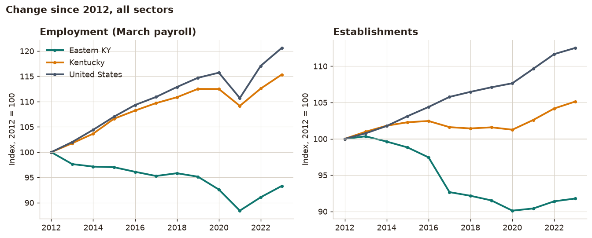
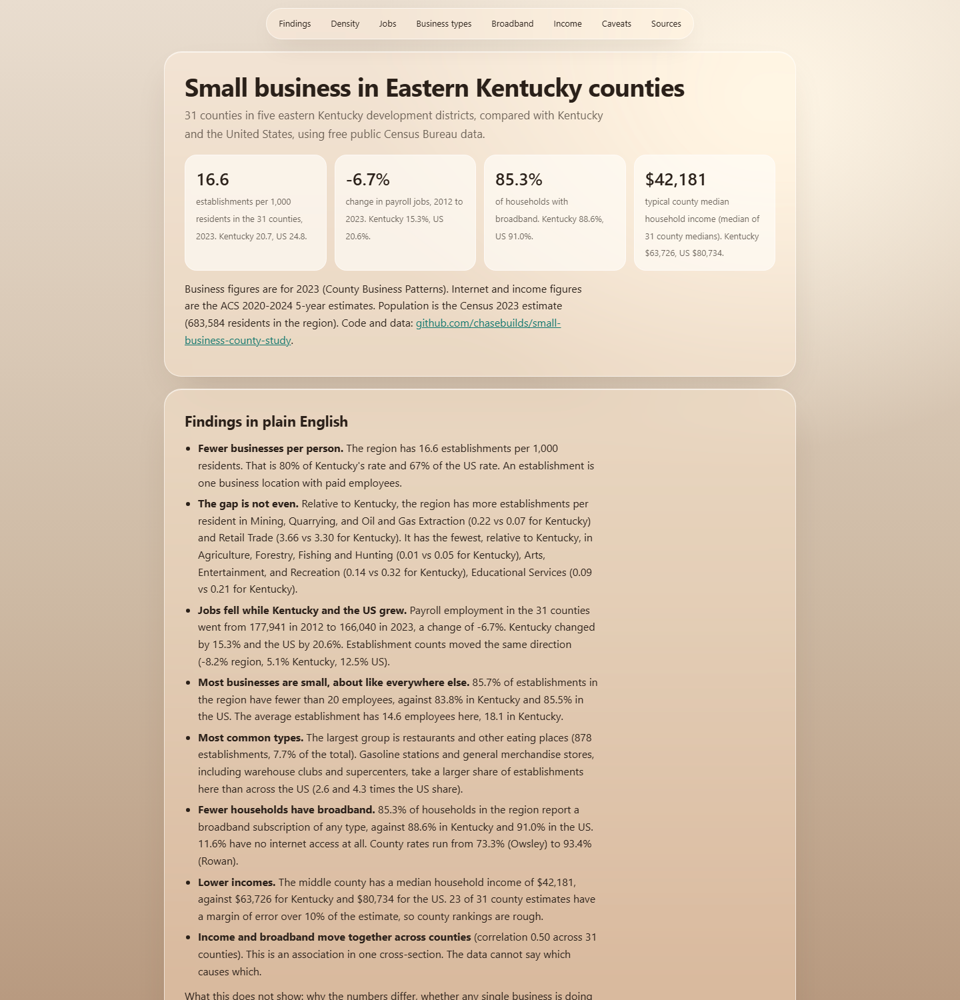

# small-business-county-study

[](https://github.com/chasebuilds/small-business-county-study/actions/workflows/ci.yml)

A reproducible analysis of small-business conditions in 31 Eastern Kentucky counties, compared with Kentucky and the United States. It uses only free public Census Bureau files, needs no API key, downloads and checksums the raw data, and rebuilds every chart and the written report from one command.

**Live report:** https://chasebuilds.github.io/small-business-county-study/

## What it found

For a business owner or lender looking at the region (31 counties, 683,584 residents in 2023):

- **Fewer businesses per person.** 16.6 employer establishments per 1,000 residents, against 20.7 for Kentucky and 24.8 for the US.
- **Jobs fell while the state and country grew.** Payroll jobs in the 31 counties changed by -6.7% from 2012 to 2023. Kentucky changed by +15.3% and the US by +20.6%.
- **Businesses are about as small as elsewhere.** 85.7% of establishments have fewer than 20 employees (Kentucky 83.8%, US 85.5%).
- **Most common types.** Restaurants and other eating places lead (878 establishments, 7.7% of the total). Gasoline stations and general merchandise stores make up a bigger slice of establishments than across the US.
- **Fewer households have broadband.** 85.3% report a broadband subscription of any type (Kentucky 88.6%, US 91.0%). County rates run from 73.3% (Owsley) to 93.4% (Rowan).
- **Lower incomes.** The middle county's median household income is $42,181, against $63,726 for Kentucky and $80,734 for the US. Most county estimates carry wide margins of error.

These describe what the data shows, not why. Business counts leave out the self-employed and most farms. See the [live report](https://chasebuilds.github.io/small-business-county-study/) for every chart and [LIMITATIONS.md](LIMITATIONS.md).





## Questions it answers

| Question | Source | Where |
| --- | --- | --- |
| Establishments per 1,000 residents, by industry | County Business Patterns 2023, Population Estimates Vintage 2024 | report: Density |
| Employment trend over the available years (2012 to 2023) | County Business Patterns 2012 to 2023 | report: Jobs |
| Broadband / internet subscription rates | ACS 2020-2024 5-year, table B28002 | report: Broadband |
| Median household income | ACS 2020-2024 5-year, table B19013 | report: Income |
| Which business types are most common | County Business Patterns 2023, 4-digit NAICS | report: Business types |

The report states each finding in plain English next to its chart. Every number in that text is computed from the data when the report is built, not typed in.

## Run it

```bash
python -m pip install -e ".[dev]"

python make.py build   # redraw all charts and docs/index.html from the committed extracts (offline)
python make.py test    # ruff + pytest
python make.py all     # download raw files, verify checksums, re-extract, rebuild everything
```

`make fetch`, `make extract`, `make build` and `make test` do the same through `Makefile`. The notebook `notebooks/analysis.ipynb` walks through the same tables.

## How the data flows

1. `sbcs/fetch.py` downloads 41 raw files (about 380 MB) from `www2.census.gov` into `data/raw/` (git-ignored). It records a SHA-256 for each in `data/checksums.json` and stops if a file later changes, so a silent republish cannot change results without you noticing. Pass `--update-checksums` to accept a new version.
2. `sbcs/extract.py` cuts the raw files down to the 31 counties, Kentucky and the US. The output is about 570 KB of CSV in `data/extracts/`, committed with a `MANIFEST.json` of checksums. Running the extract again reproduces the same files byte for byte.
3. `sbcs/clean.py` holds the pure cleaning and transform functions. `sbcs/analysis.py` builds the tables, `sbcs/charts.py` draws nine charts, `sbcs/report.py` writes the HTML.
4. CI runs on the committed extracts only, with no network: ruff, 30 pytest tests, and a full rebuild of charts and report. GitHub Pages rebuilds the report the same way on every push to `main`.

The Census Bureau API now asks for a key even at low volume (a request without one returns a redirect to a "missing key" page), so this project reads the bulk files directly instead.

## Suppressed and noisy cells

County Business Patterns protects confidentiality, and the study handles it explicitly:

- 2012 to 2016 files withhold employment for many county-sector cells (46% to 48% of 2012 to 2014 cells, 26% to 28% in 2015 and 2016). Withheld values are treated as missing, never zero.
- From 2018 on, no county-sector cell is withheld, but about a third carry a flag for noise of 5% or more (flag J).
- A regional employment total is reported only when all 31 counties have a value. Sector-level job changes therefore start in 2018. All-sector employment is complete for every year.
- Establishment counts are never withheld.

The report prints this table for 2012, 2015, 2017, 2018 and 2023.

## Definition of "Eastern Kentucky"

There is no single official boundary. This study uses the five area development districts Big Sandy, Kentucky River, Cumberland Valley, FIVCO and Gateway, 31 counties listed in [`data/counties.csv`](data/counties.csv). Edit that file and run `python make.py extract` (after `fetch`) to try another definition.

## Sources

Every file is public. Full list, with checksums, in `data/checksums.json`.

- County Business Patterns 2012 to 2023: `https://www2.census.gov/programs-surveys/cbp/datasets/<year>/cbp<yy>{co,st,us}.zip`
- ACS 2020-2024 5-year table-based summary files B01003, B19013, B28002: `https://www2.census.gov/programs-surveys/acs/summary_file/2024/table-based-SF/data/5YRData/`
- Population Estimates, Vintage 2024: `https://www2.census.gov/programs-surveys/popest/datasets/2020-2024/counties/totals/co-est2024-alldata.csv`
- CBP NAICS descriptions (NAICS 2017): `https://www2.census.gov/programs-surveys/cbp/technical-documentation/reference/naics-descriptions/naics2017.txt`

This project uses Census Bureau data but is not endorsed or certified by the Census Bureau.

## Limitations

See [LIMITATIONS.md](LIMITATIONS.md). Short version: County Business Patterns leaves out the self-employed and most farms, establishments are locations not companies, ACS county estimates have wide margins of error, and the study is descriptive, so it does not explain why any gap exists.

## License

MIT, see [LICENSE](LICENSE). Built by Chase Builds.
